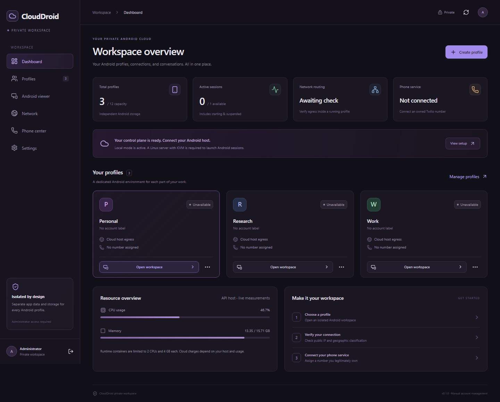

# CloudDroid

A private Android workspace control plane built with **React**, **TypeScript**, and **Vite**, preserving isolated profile management, egress route configuration, live IP/geolocation diagnostics, WebRTC virtual Android session streaming, and Twilio telephony integration.



## Quick Start

Prerequisites: Node.js 22+ and npm.

```bash
npm install
npm run dev
```

The development server runs at **http://0.0.0.0:3000**.

Build for production:

```bash
npm run build
```

## Features

- **Administrator Session & Security**: Session management with CSRF token validation, login throttling (5 attempts per 5 minutes), and sign-in/sign-out workflow (default local credentials: `admin` / `admin`).
- **Isolated Android Profiles**: Seeded initial profiles (`Personal`, `Work`, `Research`) with full CRUD, configuration-only network cloning, user-supplied account labels, recovery notes, archiving/restoration, and confirmed deletion.
- **Session Lifecycle & WebRTC Android Viewer**: Start, stop, restart, and suspend controls enforcing active session capacity limits (`VITE_MAX_ACTIVE_SESSIONS`), paired with a live 720×1280 browser WebRTC stream supporting tap/swipe gestures, printable ASCII keyboard/paste input, Android navigation controls, Google signup intent, DNS leak test intent, and location privacy toggle.
- **Network Egress & Live Diagnostics**: Configure direct host egress or user-supplied HTTP/HTTPS/SOCKS5 proxies (including `.txt`/`.conf` import and public IPv4 validation) and run dual-observer IP & geographic classification checks (`api.ipify.org` + `ipwho.is`).
- **Phone Center & Twilio Integration**: Verify Twilio credentials against the Twilio REST API (or use demo SID `AC00000000000000000000000000000000`), inspect owned `+1` US numbers, assign numbers per profile with uniqueness and history-retention checks, and enable browser voice reception via `@twilio/voice-sdk`.

## Environment Configuration

Copy `.env.example` to `.env` to customize workspace defaults:

- `VITE_ADMIN_USERNAME` — Administrator username (default `admin`)
- `VITE_ANDROID_IMAGE` — Displayed runtime image label
- `VITE_MAX_ACTIVE_SESSIONS` — Concurrent active Android session limit (default `1`)
- `VITE_MAX_PROFILES` — Maximum stored profiles (default `12`)
- `VITE_SESSION_HOURS` — Session expiration window in hours (default `8`)
- `VITE_STREAM_FPS` — Viewer frame rate target (default `5`)
- `VITE_RUNTIME_ENABLED` — Enable virtual Android runtime (`true` / `false`)
- `VITE_TURN_URL` — Optional WebRTC TURN server URL
