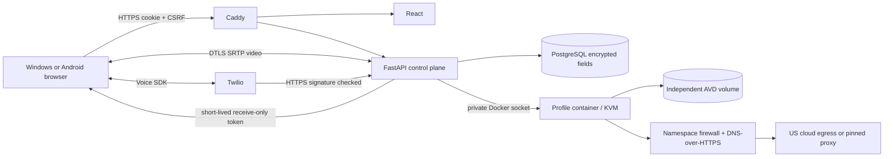

# CloudDroid architecture and implementation roadmap

Decision date: 2026-10-27. This document precedes implementation.

## Scope and feasibility
CloudDroid is a single-administrator control plane for individually operated Android environments. Three independent persistent AVD directories share one active runtime slot by default. No Google credentials, registration automation, CAPTCHA tooling, or verification bypass is implemented. Labels are user assertions, never verified account connections.

The empty Windows workspace has Python 3.13 and Node 25 but no Docker, Android SDK, KVM host, cloud credentials, or telephone credentials. Local development will run the real control plane with SQLite and an explicitly unavailable Android adapter. There is no fake Android screen or simulated successful network/provider state. PostgreSQL and Linux Docker/KVM are the deployment path.

## Selected design
- React + TypeScript + Vite: responsive single page application. Next.js adds an unnecessary second application server for this admin product.
- FastAPI + SQLAlchemy: same-origin API, SQLite locally, PostgreSQL in Compose.
- Official Android SDK emulator, API 35 Google APIs x86_64 image, Linux /dev/kvm. Image availability and SDK licenses must be checked on build. Google APIs images contain Google APIs/services; a Play Store and device certification are separate properties, never promised. Play-enabled images may be selected only under their licenses.
- Separate AVD volume, process/container and network namespace per profile. Cold stop persists data; suspend uses Docker pause and still reserves RAM. Archive stops without deleting. Clone copies network/privacy configuration only, never Android disks, accounts, inboxes, or telephone assignments.
- Browser WebRTC via aiortc and ADB frame capture; encrypted DTLS/SRTP, authenticated same-origin signaling and API input. Initial target 5 fps, no Android audio, pinch/IME/full Unicode clipboard not promised. This is an honest baseline with native emulator WebRTC migration documented below.
- Default US cloud public egress. Optional HTTP CONNECT, TLS-wrapped HTTPS CONNECT, or SOCKS5 TCP routing. Container firewall redirects emulator-owned TCP through a connector; only that connector may reach the pinned public proxy endpoint. DNS uses DoH through the same route. UDP beyond DNS and IPv6 are blocked in proxy mode. No direct fallback exists. Fail-closed protection is a firewall property, not a health-check property.
- Twilio adapter: owned-number inventory and assignment checks, signed inbound SMS/voice/status webhooks, encrypted SMS/call metadata, receive-only browser Voice SDK tokens. No number purchasing or outbound calls/messages.
- Caddy HTTPS and same-origin frontend/API. ADB and Docker never exposed publicly. A single privileged runtime agent is avoided: the trusted API on the dedicated host controls Docker. Docker socket access is root-equivalent and must never be given to untrusted tenants.

## Security boundaries
One administrator can intentionally read all profiles. Isolation separates profile app state, not mutually hostile administrators. Emulator/KVM/container escape resistance is weaker than separate VMs; use one VM per tenant for future multi-tenant deployments. Android userdata needs an encrypted host disk (provider encryption at rest or LUKS); application-level field encryption does not encrypt the AVD. Backups must include the encryption key through a separate secret channel. Never expose Docker, ADB, PostgreSQL, or an unauthenticated stream to the internet.

Sessions use random opaque tokens stored hashed, HttpOnly SameSite cookies, expiry/revocation, password hashing, CSRF checks, exact Origin checks, and login throttling. Sensitive profile metadata, proxies, provider credentials, messages, and call metadata use Fernet authenticated encryption. Logs contain request IDs/status, not request bodies, URLs with secrets, SMS contents, tokens, or provider exception text. Deletion is irreversible and explicitly confirmed in the interface. External IP diagnostics expire; a successful probe is not an ongoing guarantee of location or account eligibility.

## Official evidence and compatibility
- https://github.com/google/android-emulator-container-scripts : current experimental Google repository documents Python 3.10+, Linux Docker/KVM, cloud nested virtualization and a native gRPC Rtc/WebRTC gateway. Docker Desktop on Windows/macOS is not its KVM deployment path. Its prebuilt example API-30 image is not our default.
- https://developer.android.com/studio/run/emulator-acceleration : matching CPU architecture and KVM; current GPU modes include swiftshader.
- https://developer.android.com/studio/run/emulator-commandline : separate writable AVD userdata, -accel on, -dns-server, headless options. An Android app-level proxy alone is insufficient for fail-closed routing.
- https://developer.android.com/studio/run/managing-avds : Google APIs and Play Store system images differ.
- https://docs.cloud.google.com/compute/docs/instances/nested-virtualization/overview and /enabling : select a supported machine family and enable nested virtualization; verify /dev/kvm before installing.
- https://aiortc.readthedocs.io/en/latest/api.html : RTCPeerConnection/video track API. Control plane TCP/TLS plus TURN can be needed on restrictive networks.
- https://fastapi.tiangolo.com/deployment/docker/ : build application image directly.
- https://www.twilio.com/docs/phone-numbers/api/incomingphonenumber-resource : account-owned numbers and SMS/voice capabilities.
- https://www.twilio.com/docs/usage/security : validate signatures over the configured public URL and all submitted form fields.
- https://www.twilio.com/docs/voice/sdks/javascript : browser inbound voice requires an identity, token, microphone and supported secure browser.
- https://www.twilio.com/docs/usage/trials/try-out-voice : trial restrictions apply; a trial is not permanent free telephony.

These sources establish API/design feasibility, not a tested deployment. Dependency lockfiles and tests record the versions actually installed here. Android SDK/Compose/Linux runtime and real SMS/call acceptance remain separately gated on a provisioned host and real credentials.

## Incremental roadmap and acceptance gates
1. Architecture (this document), then authenticated persistent API, encrypted profile CRUD, three initial profiles, UI and tests.
2. Runtime adapter and official SDK container; fail-closed network module; WebRTC viewer and input; deployment scripts. Validate all code locally, require Linux/KVM acceptance before calling Android deployed.
3. Twilio inventory, assignment, signed idempotent ingestion and receive-only browser audio. Unit tests use explicit provider fixtures; live tests require real credentials.
4. Monitoring, encrypted stopped-profile backup/restore procedures, resource limits, hardening and deployment acceptance checklist.

## Hosting shortlist

| Option | Feasibility | Decision |
|---|---|---|
| GCE N2 in a US region, nested virtualization enabled | Official KVM support; metered non-spot VM; host/image still needs testing | Reference deployment, smallest starting allocation 2 vCPU / 8 GB |
| AWS bare-metal / supported Azure nested-virtualization sizes | Alternatives documented by Google's container project; account-specific capacity/cost unverified | Supported architecture direction, no cheaper verified quote established |
| GCE E2 free tier | Official nested virtualization restrictions exclude E2 | Incompatible with this accelerated runtime |
| Hetzner Cloud | Provider FAQ explicitly disallows nested virtualization | Excluded despite attractive ordinary VPS pricing |
| netcup VPS/Root Server | Provider documentation says SVM/nested virtualization cannot be activated | Excluded; KVM-based hosting does not itself grant nested KVM |
| Windows Docker Desktop | Not Google's documented KVM deployment target | Local control plane only; use a separately validated Linux host |

Provider evidence: https://docs.hetzner.com/cloud/servers/faq/ and https://www.netcup.com/en/helpcenter/documentation/server . The selected GCE reference is the least-resource dependable architecture supported by the verified shortlist, not a claim of a globally lowest market price. A smaller quote from another provider is useful only after explicit nested-KVM support and US placement are verified.

## Native streaming upgrade
Google now documents a native Rtc v2 gateway under gateway/ and React components under js/. It is experimental and tied to the emulator release. Replace the baseline capture adapter after testing a pinned release, authenticated signaling, profile-bound authorization and TURN topology. Do not place its unauthenticated gateway directly on the public internet. The initial implementation does not claim that native integration has been deployed.
